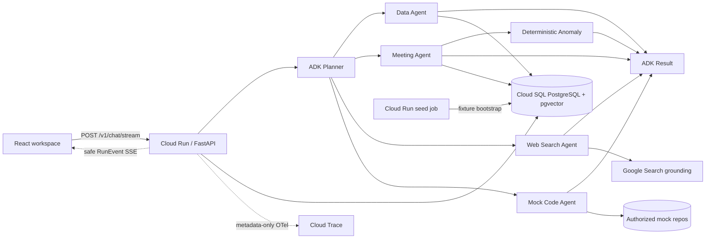

# Lotus architecture

Lotus is deployed as one authenticated Cloud Run service hosting the FastAPI API and compiled
React workspace. Google ADK is the agent framework. The browser never selects an agent mode: a
schema-validated Planner creates the execution graph and Result always runs last.

The editable Mermaid source above is the source of truth. Exported hackathon assets are in
`docs/assets/lotus-architecture.svg` and `docs/assets/lotus-architecture.png`.

## Runtime boundaries

- `RUNTIME_MODE` controls generation. Cloud Run uses live Planner, Result, Meeting Analysis, and
  Google Search agents.
- `EMBEDDING_RUNTIME_MODE` independently controls indexing/query embeddings. Cloud Run uses the
  deterministic 768-dimensional `fixture:hash-v1:768` embedder, so query vectors are computed
  locally without a model call.
- Deployed Cloud Run uses `STORE_BACKEND=postgres` and reads all searchable and mutable workspace
  state from Cloud SQL. Packaged fixtures are seed inputs used only by the migration/seed jobs;
  API startup never reads or embeds them.
- `STORE_BACKEND=memory` remains available only for deterministic tests and explicit local demos.
- Planning/Jira and Docs/Confluence selections use ID-only workspace context. Their final browser
  wiring waits for Vanshika's branch; server-side adapters must resolve IDs and re-check ACLs.

## Streaming and observability

`POST /v1/chat/stream` emits schema-validated events for run start, agent/tool node state, bounded
answer deltas, completion, failure, and heartbeat. Events contain counts, timings, and redacted
previews—not prompts, tokens, system instructions, complete transcripts, or hidden reasoning. The
same execution and session IDs correlate the session-scoped Run inspector, structured logs, ADK
spans, and Google Cloud Trace. Server-side run history is intentionally not persisted.

## Security invariants

Every retrieval path filters tenant, project, principals, and active embedding model before
ranking. Mock code access additionally checks repository scope, rejects traversal, bounds file and
result sizes, and is read-only. Raw HTML is disabled in rendered Markdown. Prompt/response span
capture is disabled in the Cloud Run environment.
